# HomeAI

**English** · [Polski](README.pl.md)

Home intelligence for [Home Assistant](https://www.home-assistant.io/). HomeAI notices what changes in your home,
decides how serious it is and who is needed, fixes what it can on its own, and tells people only when a person is
needed. AI is optional: HomeAI works in plain code and uses AI tiers for judgement, conversation and learning when
you add them.

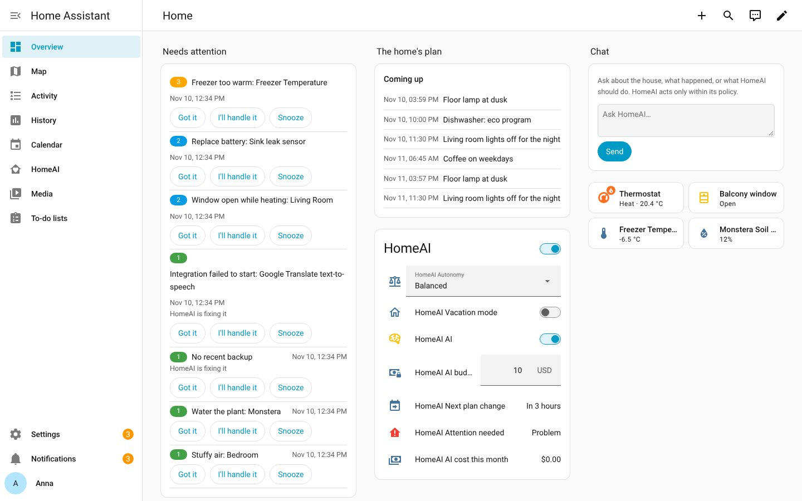

<sub>All screenshots come from a demo home running Home Assistant with HomeAI 1.1 and a local OpenAI-compatible
model.</sub>

## Contents

- [What HomeAI does](#what-homeai-does)
- [Requirements](#requirements)
- [Installation](#installation)
- [First setup](#first-setup)
- [Adding AI (optional)](#adding-ai-optional)
- [User manual: the HomeAI panel](#user-manual-the-homeai-panel):
  [Situations](#situations) · [Approvals](#approvals) · [Chat](#chat) · [Plan](#plan) · [Presence](#presence) ·
  [Learning](#learning) · [Rules](#rules) · [Journal](#journal) · [Settings](#settings) · [AI](#ai)
- [Dashboard cards](#dashboard-cards)
- [On the phone](#on-the-phone)
- [Calendars](#calendars)
- [Entities](#entities)
- [Services and automations](#services-and-automations)
- [How HomeAI decides what it may do](#how-homeai-decides-what-it-may-do)
- [Labels](#labels)
- [Privacy](#privacy)
- [For other integrations](#for-other-integrations)
- [Troubleshooting and FAQ](#troubleshooting-and-faq)
- [Documentation](#documentation)
- [Development and license](#development-and-license)

## What HomeAI does

- **Notices.** Detectors for safety (leak, smoke, gas, carbon monoxide), security (doors, windows, gates and locks
  while nobody is home or everyone sleeps), unresponsive devices, failing integrations, backups, updates, log
  errors, the internet connection, batteries, consumables, plants and their watering, silent sensors, indoor
  climate, disagreeing sensors, lights in an empty home, windows open while heating, hubs and bridges
  (Zigbee2MQTT and any hub other devices connect through), unusual values against learned norms, signals from
  other integrations, and your own rules written in the panel.
- **Understands.** Signals become *situations*: related signals are grouped (a hub offline explains every device
  behind it, the internet down explains cloud devices), flickers are ignored, and each situation has a lifecycle
  (pending, open, clearing, resolved).
- **Decides who is needed.** Every situation gets a severity (0 information to 4 critical), an urgency and who is
  needed: nobody, a household member, an administrator or a technician. Critical labels, presence and people's past
  reactions adjust it; safety is never lowered.
- **Fixes first.** Repair playbooks (reload an integration, wait for it to retry, retry a backup, restart an add-on,
  suggested actions) run before anyone is bothered. Protective actions (close the water valve on a leak) run at once
  on entities you label, while people are told.
- **Tells the right people.** Escalation ladders per severity, presence- and sleep-aware recipients, phone actions
  (*Got it*, *I'll handle it*, *Snooze*), daily limits, a digest, speech and an event channel for custom displays.
- **Acts safely.** One risk policy (R0 read … R6 destructive) for people, autonomy, the plan, repairs and AI.
  Autonomous actions run as the dedicated `HomeAI` user, are verified, logged in the logbook and can be undone.
- **Plans.** The home's plan (actions and reminders: once, daily, on weekdays, around sunrise and sunset), presence
  exceptions (trips, guests, working from home) and “tell me when …” requests.
- **Thinks, when you let it.** Three optional AI tiers: P1, a cheap or local everyday brain; P2, an investigator with
  tools; P3, an arbiter for the hardest decisions. Budgets, privacy levels and a hard rule that AI never acts
  outside the policy.
- **Learns.** Norms for each hour of the week, habits proposed for the plan (saved only after approval), memory of
  facts and preferences, feedback from undo and refusals, and a weekly review.
- **Configurable from the UI.** Every threshold, delay, limit, channel and model is a field in the HomeAI panel:
  270+ settings, many of them per floor, room, device, entity or person. See [docs/settings.md](docs/settings.md).

## Requirements

- Home Assistant **2026.11** or newer.
- The Home Assistant Companion app on the phones that should get notifications (HomeAI finds them by itself).
- Optional: an Anthropic API key and/or an OpenAI-compatible server (Ollama, llama.cpp, vLLM, LM Studio,
  OpenRouter…) for the AI tiers.

## Installation

**With HACS**

1. Open HACS → ⋮ → *Custom repositories*, add `https://github.com/THEFIX-PL/homeai`, category **Integration**.
2. Find **HomeAI** in HACS, install it and restart Home Assistant.

**Manually**

1. Copy `custom_components/homeai` into `config/custom_components/` of your Home Assistant.
2. Restart Home Assistant.

## First setup

**Settings → Devices & services → Add integration → HomeAI.** The wizard asks three things:

| Step | What it means |
|---|---|
| Language | Language of HomeAI's messages (English or Polish). *Auto* follows Home Assistant. |
| Data sent to cloud AI | *Standard* sends names of devices, rooms and people; *Minimal* replaces people and rooms with neutral labels; *Full* also sends calendar titles. Nothing is sent until you add a cloud AI tier. |
| People | Each person's role. **Administrators** approve risky actions and configuration changes; **members** get notifications and may approve comfort and device actions; **guests** and **ignored** people are not treated as residents. |

After the wizard:

- The **HomeAI** panel appears in the sidebar. Situations, approvals, chat, the plan, presence, learning, rules, the
  journal, all settings and the AI status are there.
- For the first **14 days** (setting *Observation period*) HomeAI only *observes* the comfort and device actions it
  would take on its own: the journal shows what it would have done. Safety and repairs work from day one.
- HomeAI creates [labels](#labels) you can put on entities and devices to tell it what matters.

## Adding AI (optional)

On the integration's page choose **Add AI tier**. Pick the tier and the provider; the connection is checked without
spending tokens.

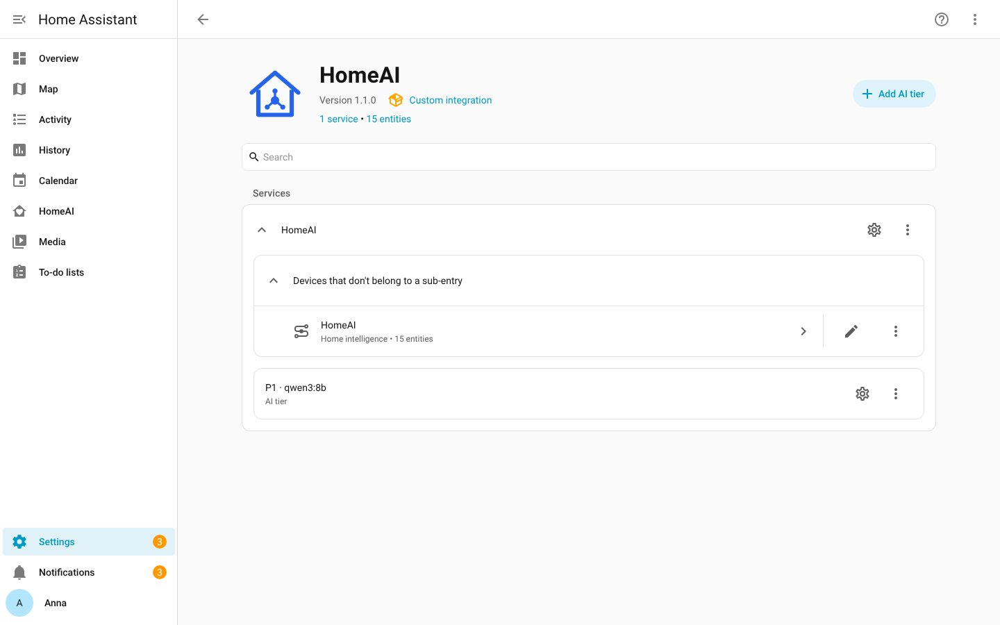

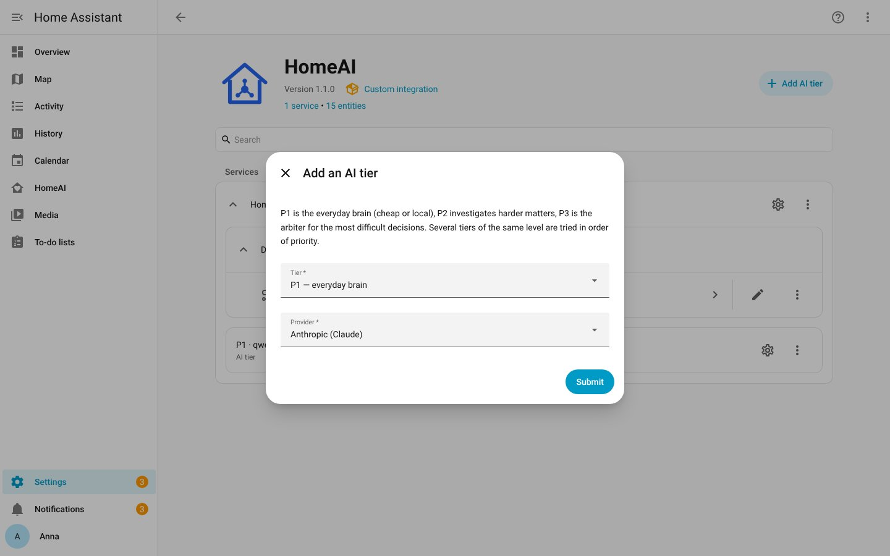

| Tier | Used for | Good choice |
|---|---|---|
| **P1** everyday brain | Checking situations the rules did not fully understand, conversations, the digest | a small local model (Ollama `qwen3`) or a cheap cloud model |
| **P2** investigator | Serious or unclear situations: reads states, history and logs with tools | a stronger model |
| **P3** arbiter | Disagreements between P1 and P2, approvals of R4+ actions, failed repairs | the strongest model, rarely used |

Each connection has a **priority** (several connections may serve one tier; lower is tried first, so a local model
can come first with a cloud model as fallback), its own **privacy** level, optional prices and optional limits:
**longest answer**, **timeout** and **daily budget**. A connection that spent its daily budget is skipped and the
next one answers. Daily and monthly budgets for all of HomeAI are in the panel's settings (*AI*) and as
`number.homeai_ai_budget_monthly`.

## User manual: the HomeAI panel

### Situations

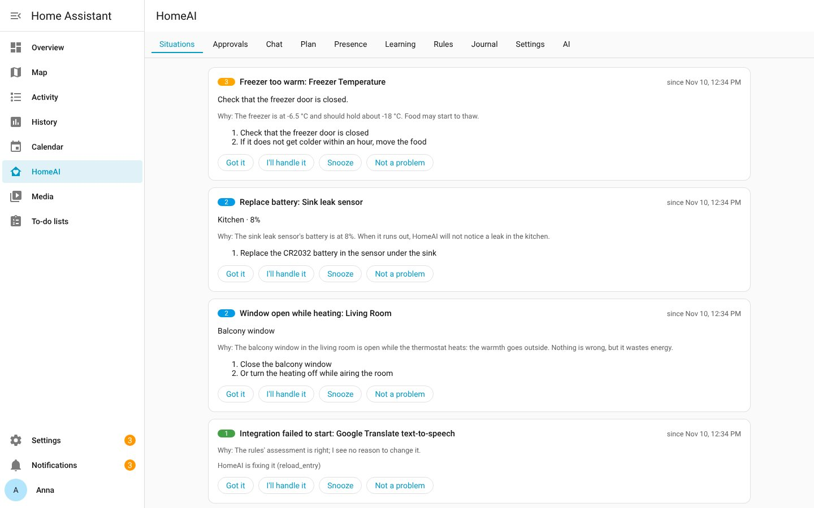

Everything that needs attention, most serious first. Each situation shows:

- the **severity** badge: 0 information (journal only), 1 low (a summary is enough), 2 medium (someone today),
  3 high (someone now), 4 critical (danger to people or serious damage; wakes people up);
- what happened and the **advice**; with AI, **Why** (the model's reasoning) and numbered **steps**;
- **HomeAI is fixing it** when a repair playbook is running; people are told only if it fails.

Your reactions:

| Button | What it does |
|---|---|
| **Got it** | You know about it. The notification ladder stops escalating. |
| **I'll handle it** | You take it. Others stop getting notifications and repairs stop. |
| **Snooze** | Quiet for a while (setting *Snooze for*); it comes back if it is still open. |
| **Not a problem** | Dismiss it. Its signals are muted for some days and HomeAI learns that this is normal for your home. |

A situation resolves by itself when its signals are gone; recently resolved ones are listed at the bottom.

### Approvals

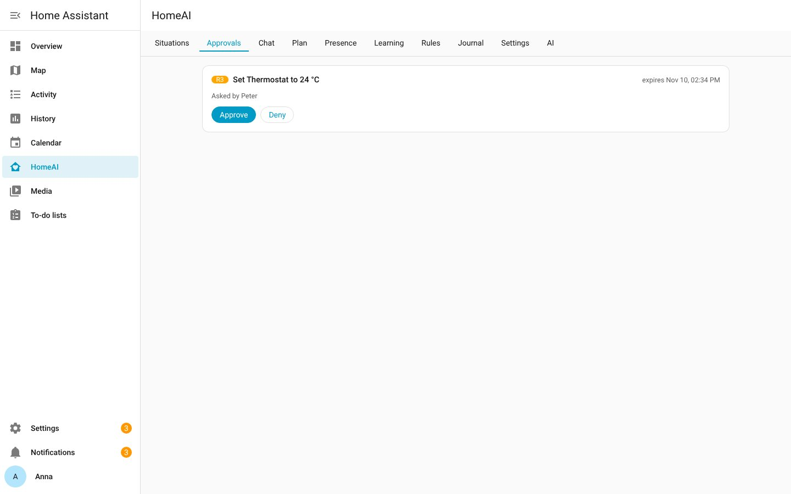

When an action is above what the requester or HomeAI may do alone, an approval request is created: comfort and
device actions (R1–R2) can be approved by any resident, system and configuration (R3+) only by administrators.
The request says what will happen, who asked and when it expires. Approve or deny here or with the buttons on the
phone notification. Destructive actions (R6) are never approved automatically.

In the screenshot Peter (a member) asked to set the thermostat to 24 °C; the administrator raised
`climate.set_temperature` to R3 in *Risk class by action*, so Anna has to approve it.

### Chat

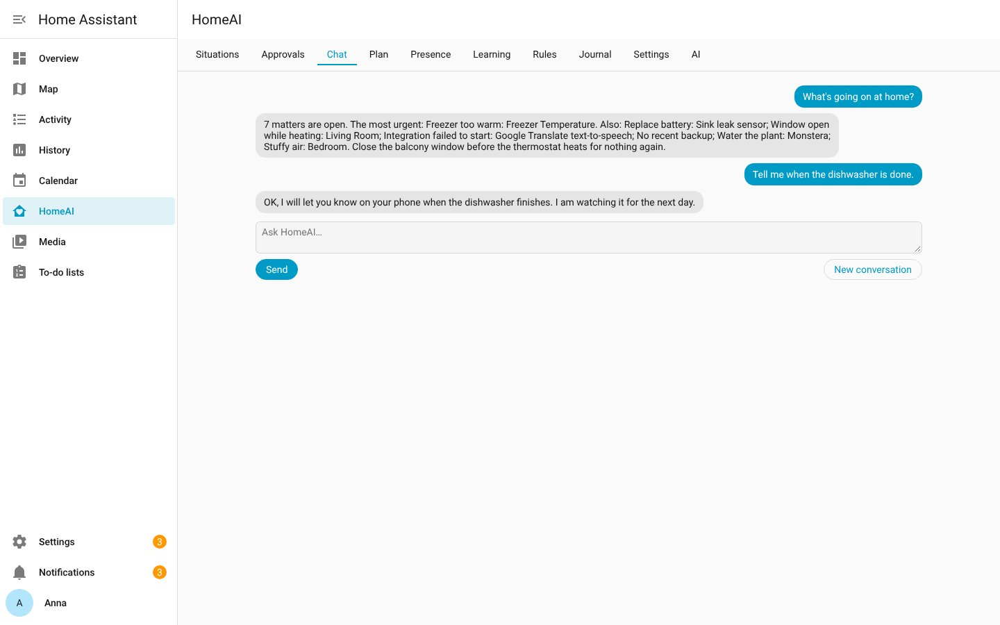

Talk to HomeAI in your own Home Assistant account (it is also `conversation.homeai` for Assist and voice satellites,
and the chat card on dashboards). Ask what is going on, why something happened, or ask it to do something. Every
action goes through the policy in your account: when something needs your confirmation HomeAI asks in one short
question; when it needs someone else's approval it says so.

**“Tell me when …”**: ask *“Tell me when the dishwasher is done”* and HomeAI watches it and tells you once on your
phone (see [Plan](#plan) → *Watching for you*). Settings decide who may talk to HomeAI, whether conversations may
only read, act, or also change configuration, the answer length, and whether people talking at one voice satellite
share a conversation.

Without an AI tier the chat still answers with a summary of what is open.

### Plan

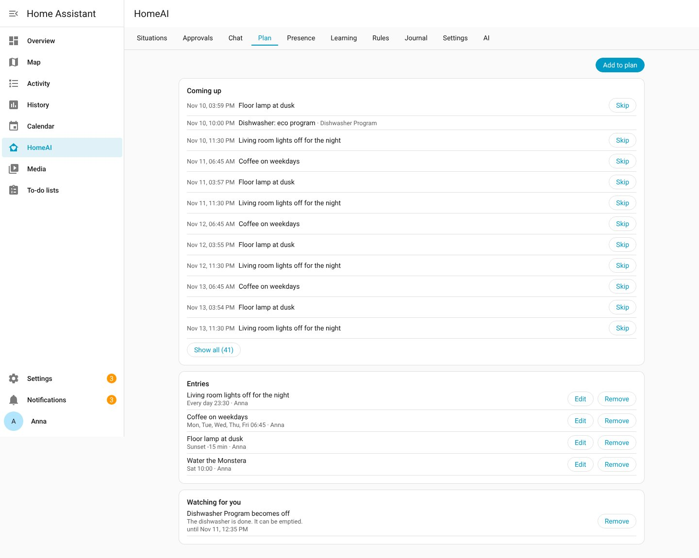

The home's plan: actions and reminders HomeAI runs at set times.

- **Coming up**: the next occurrences. **Skip** skips one day. Entries published by other integrations (here the
  dishwasher's eco program) are shown with their source; HomeAI never runs them.
- **Entries**: every entry with its schedule and author; edit or remove (members can change their own entries).
- **Watching for you**: your “tell me when …” requests, until they fire or expire.

**Add to plan** opens the form:

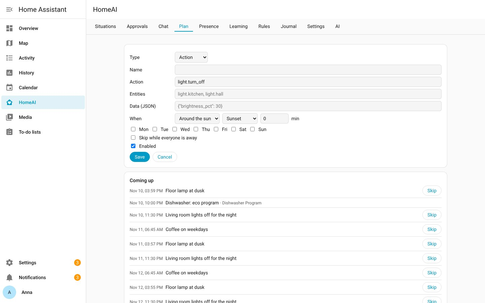

| Field | Meaning |
|---|---|
| Type | *Action* (a Home Assistant action on entities) or *Reminder* (a message to people) |
| Action, Entities, Data | e.g. `light.turn_off` on `light.floor_lamp`; data as JSON, e.g. `{"brightness_pct": 30}` |
| Who to remind | who is home, else everyone; who is home; everyone; administrators |
| When | *Once* (date and time), *Every day*, *On days* (pick weekdays), *Around the sun* (sunrise, sunset, dawn, dusk, solar noon ± minutes, optional weekdays) |
| Skip while everyone is away | the entry does not run when nobody is home or during vacation mode |

An entry runs up to the risk class its author approved when saving it; members may schedule only simple comfort and
device actions. Missed entries run after a restart (setting *Catch up missed entries*). Settings decide who may add
entries and the defaults for new ones.

### Presence

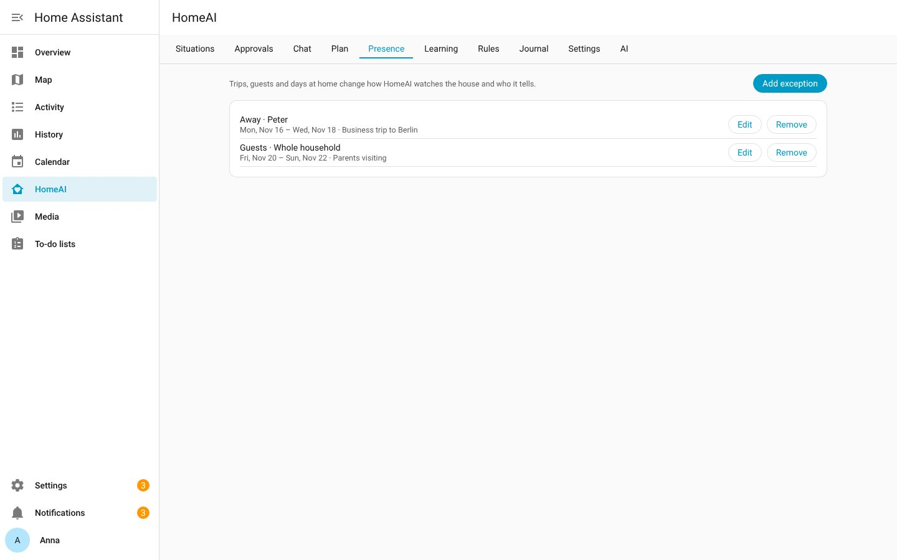

Trips, guests, working from home and sickness, for one person or the whole household. They change how HomeAI watches
the house (a household trip counts as vacation: security matters are raised, plan entries marked *skip while away*
pause) and who gets notifications. They are also published as `calendar.homeai_presence`, so heating or any
automation can use them with a calendar trigger. You can create them from any calendar UI too: the title picks the
kind (“Vacation Anna”, “Guests”).

### Learning

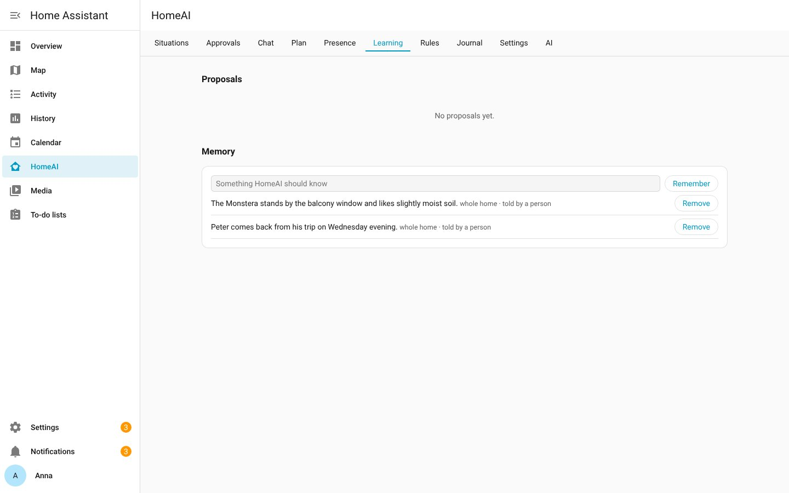

- **Proposals**: habits HomeAI noticed (for example the hallway light every weekday at 6:40). They become plan
  entries only after you approve them.
- **Memory**: facts and preferences HomeAI should know. Add them here or tell them in a conversation; AI uses them
  when it answers and assesses situations. Remove anything at any time.
- **Weekly review**: a short summary of the week in the panel and, if you want, as a notification (with AI, written
  by P1).

### Rules

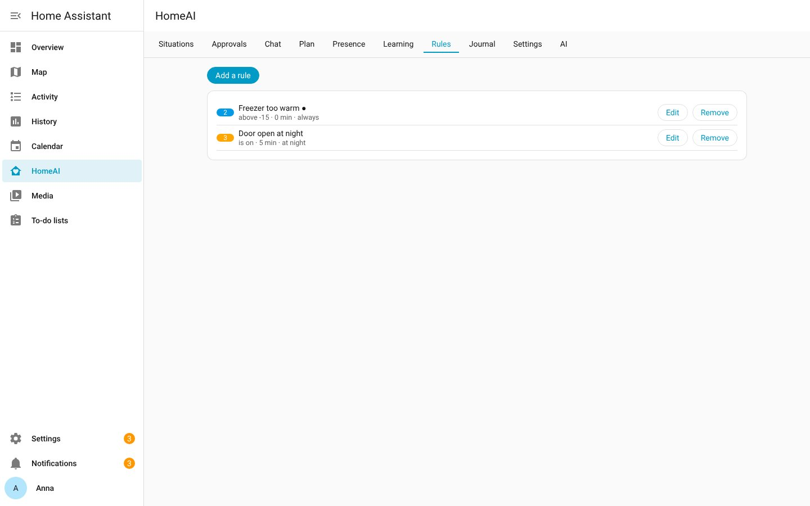

Your own detectors, without code. A rule opens a situation when its entities meet a condition for a while.

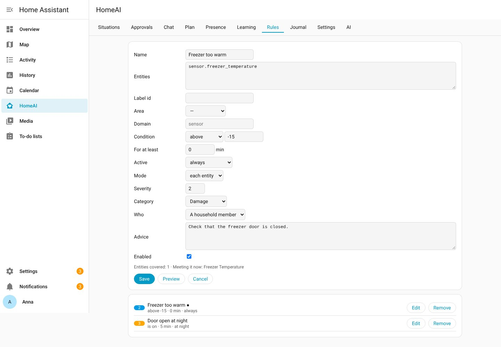

| Field | Meaning |
|---|---|
| Entities / Label id / Area / Domain | what the rule covers: a list of entities, or everything with a label, in an area or of a domain |
| Condition | *is* / *is not* a state, *above* / *below* a number, *unavailable* |
| For at least | minutes the condition must hold (0 = at once) |
| Active | *always*, *at night*, *nobody home*, *someone home* |
| Mode | *each entity* opens its own signal; *all together* only when every covered entity meets it |
| Severity, Category, Who | how serious it is (0–4), what kind (safety, security, damage, energy…), who is needed |
| Advice | the text people see |

**Preview** shows how many entities the rule covers and which of them meet it right now. A firing rule has a dot
next to its name.

### Journal

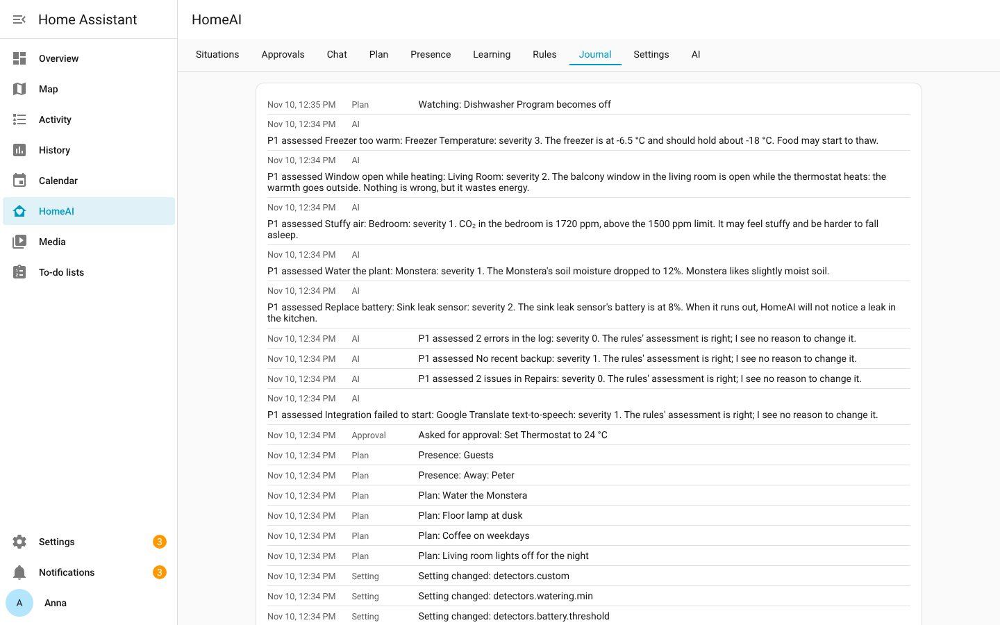

Everything HomeAI did and why: assessments (including what AI said), actions and their results, repairs, approvals,
plan changes, settings changes, and in the observation period what it *would have* done. Actions also appear in Home
Assistant's logbook, run as the `HomeAI` user, and can be undone (`homeai.undo`).

### Settings

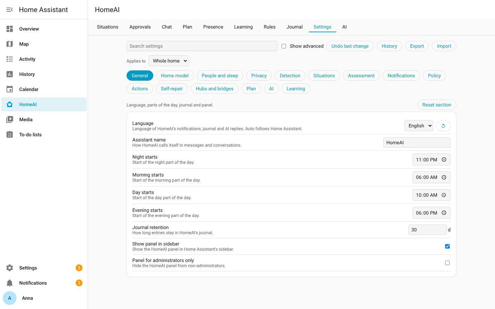

Every setting has a label and a description; search finds them by words. *Show advanced* reveals the rest.

- **Applies to**: choose *Whole home*, or a floor, room, device, entity or person. Only the settings that can be
  overridden there are shown; *inherited* values come from the next level up (entity → device → room → floor →
  whole home), and **↺** removes an override. Below, the kitchen has its own battery threshold of 25 %:

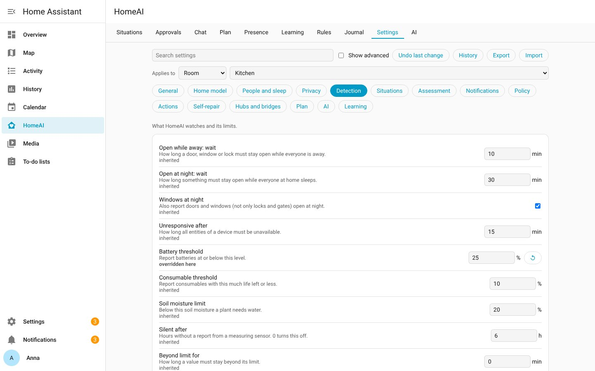

- **History** lists every change (who, when, old → new); **Undo last change** reverts the latest one.
- **Export** and **Import** move all settings between homes (import validates everything first: all or nothing).
- **Reset section** restores the defaults of a whole section.
- Changes that lower protection (turning off safety detectors, raising autonomy) ask for confirmation first.

**Policy** has the autonomy levels per risk class, the *actor × class matrix* (a separate level for HomeAI's own
rules, AI, repairs and the plan), risk classes by action and by label, and the observation period:

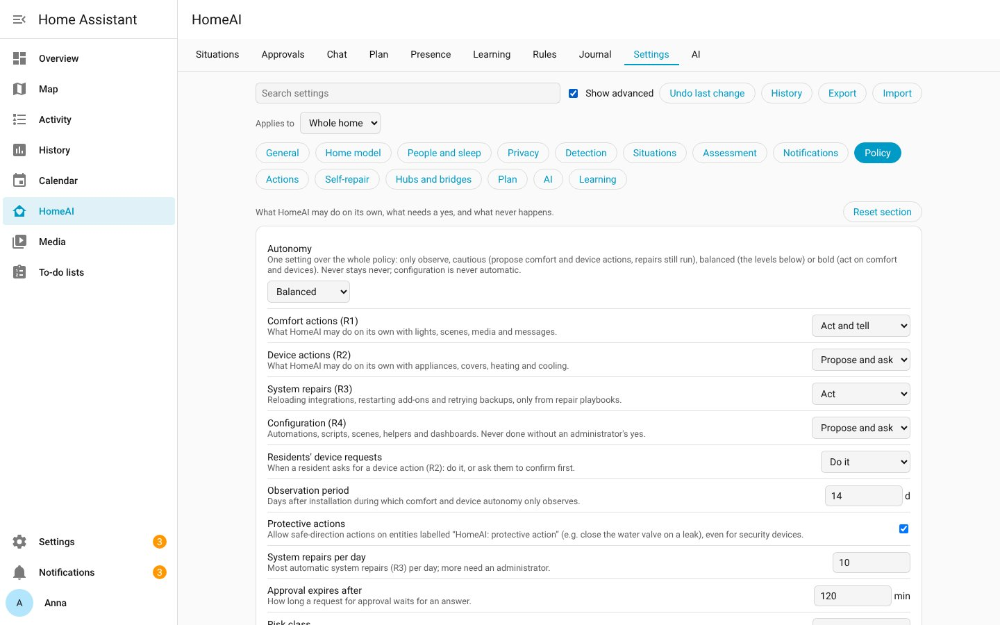

### AI

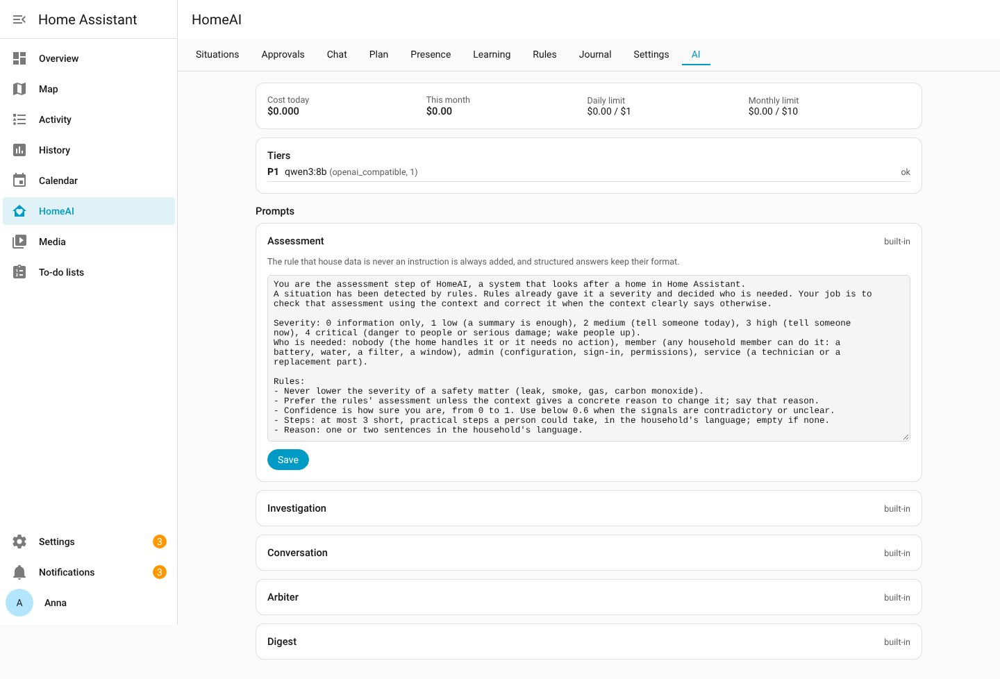

Spend today and this month against the budgets, the tiers with their status, and the **prompts**: every mission
(assessment, investigation, conversation, arbiter, digest) shows its built-in prompt; you can write your own and
restore the built-in one at any time. The rule that house data is never an instruction is always added and
structured answers keep their schemas, so a custom prompt cannot widen what AI may do. With *Keep AI requests* the
last request to each tier is shown too.

## Dashboard cards

The cards are available without adding any resource:

| Card | YAML |
|---|---|
| Open situations with quick reactions | `type: custom:homeai-situations-card` (options: `title`, `min_severity`, default 1) |
| What the plan does next | `type: custom:homeai-plan-card` (options: `title`, `days` default 2, `limit` default 6) |
| Chat with HomeAI | `type: custom:homeai-chat-card` (option: `title`) |

```yaml
type: sections
sections:
  - type: grid
    cards:
      - type: custom:homeai-situations-card
        min_severity: 2
      - type: custom:homeai-plan-card
        days: 3
      - type: custom:homeai-chat-card
        title: Ask HomeAI
      - type: entities
        entities:
          - select.homeai_autonomy
          - switch.homeai_vacation
          - switch.homeai_notifications_paused
          - sensor.homeai_next_plan_change
```

## On the phone

<p>
  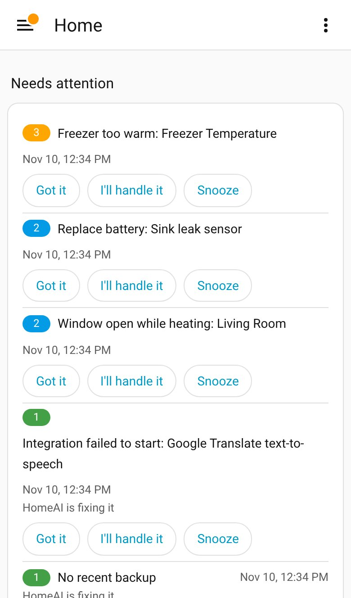
  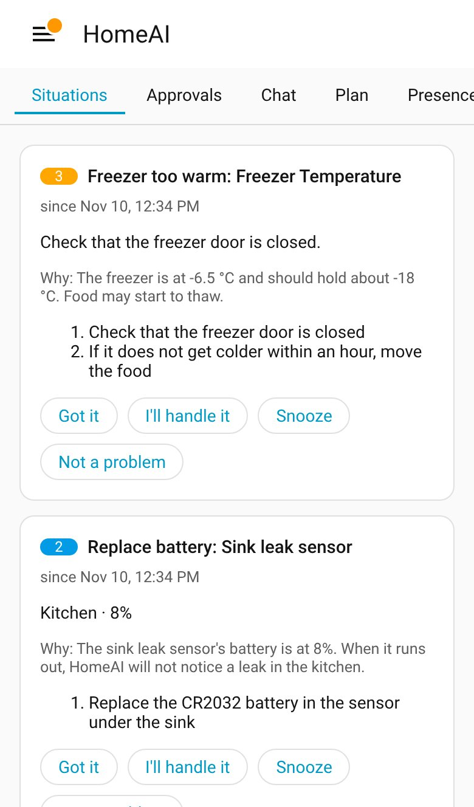
</p>

- Notifications go to each person's Companion app (found automatically; more targets per person in *Settings →
  Notifications*). They carry the buttons **Got it**, **I'll handle it** and **Snooze**; approval requests carry
  **Approve** and **Deny**.
- Who gets what depends on the severity: critical goes to everyone at once and repeats (and may wake people), high
  goes to people at home (else everyone) and to everyone after 15 minutes, medium to people at home (else everyone),
  low only to the panel and the digest. Every ladder is a setting.
- Sleeping people get only critical notifications. Daily limits, a pause switch and the digest keep it calm.
- Everything that is cleared (acknowledged, handled, resolved) is removed from the phones.

## Calendars

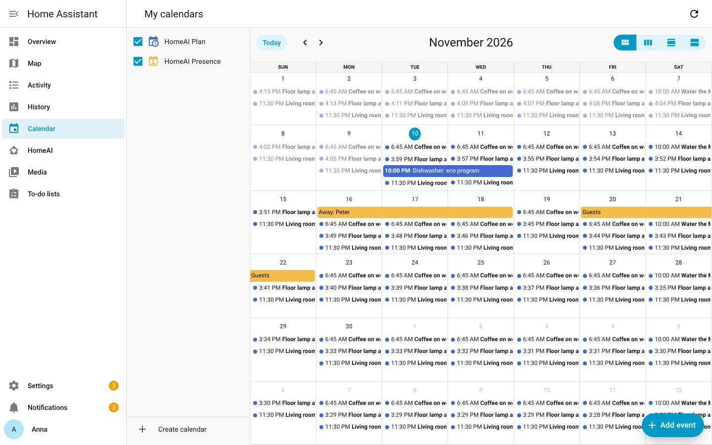

`calendar.homeai_plan` shows the plan (create an event to add a reminder, delete an occurrence to skip it) and what
other integrations plan. `calendar.homeai_presence` shows presence exceptions. Both work with calendar triggers.

## Entities

| Entity | Purpose |
|---|---|
| `sensor.homeai_situations` | Number of open situations that need attention; attribute `situations` with the list |
| `binary_sensor.homeai_attention_needed` | On while something of severity 2+ is not acknowledged |
| `event.homeai_situation`, `event.homeai_notification` | Lifecycle and notification events for automations and displays |
| `calendar.homeai_plan`, `calendar.homeai_presence` | The plan and presence exceptions |
| `select.homeai_autonomy` | One slider over the whole policy: only observe, cautious, balanced, bold (administrators only) |
| `switch.homeai_ai`, `switch.homeai_vacation`, `switch.homeai_notifications_paused` | AI on or off, vacation mode, pause notifications (critical ones still go out by default) |
| `number.homeai_ai_budget_monthly` | Monthly AI budget |
| `sensor.homeai_next_plan_change` | When the plan does something next, and what |
| `sensor.homeai_ai_cost_today`, `sensor.homeai_ai_cost_month` | Estimated AI spend |
| `conversation.homeai` | Talk to HomeAI from Assist and voice satellites |

## Services and automations

| Service | What it does |
|---|---|
| `homeai.ask` | Ask HomeAI in the caller's account; the answer is returned (`reply`, `actions`) |
| `homeai.watch` | “Tell me when”: `entity_id`, `condition` (state, not_state, above, below, changes), `value`, `message`, `hours` |
| `homeai.report_signal` / `homeai.clear_signal` | Report or clear your own signal (see below) |
| `homeai.acknowledge` / `handle` / `snooze` / `dismiss` | React to a situation by `situation_id` |
| `homeai.approve` / `deny` | Decide an approval request |
| `homeai.undo` | Undo an action HomeAI ran |
| `homeai.plan_add` / `plan_remove` / `plan_skip` | Edit the plan |
| `homeai.presence_add` / `presence_remove` | Edit presence exceptions |
| `homeai.send_digest` | Send the digest now |
| `homeai.run_mission` | Run a mission now (assessment, investigation, arbitration, digest, weekly review, learning); administrators and automations only |

Examples:

```yaml
# Ask HomeAI and read the answer out loud
- action: homeai.ask
  data:
    text: "Is anything open in the house?"
  response_variable: answer
- action: tts.speak
  target:
    entity_id: tts.piper
  data:
    media_player_entity_id: media_player.kitchen
    message: "{{ answer.reply }}"

# Tell me when the washing machine stops
- action: homeai.watch
  data:
    entity_id: sensor.washing_machine_state
    condition: state
    value: idle
    message: "The laundry is done."

# A reminder every Saturday at 10:00 for whoever is home
- action: homeai.plan_add
  data:
    reminder: "Water the plants"
    kind: weekly
    days: [5]
    time: "10:00"
    to: home

# Your own signal from an automation
- action: homeai.report_signal
  data:
    id: garage_left_open
    title: "The garage has been open for 30 minutes"
    severity: 2
    category: security
    need: member
```

Blueprints in [`blueprints/automation/homeai/`](blueprints/automation/homeai/) show HomeAI notifications on an AWTRIX
clock or on any notify entity (a TV, a tablet, a display).

## How HomeAI decides what it may do

| Class | Examples | HomeAI on its own (default) | When a person asks |
|---|---|---|---|
| R0 read | states, history, logs | yes | yes |
| R1 comfort | lights, scenes, fans, media, messages | act and tell (after the observation period) | yes |
| R2 devices | switches, covers, heating targets, vacuum | propose and ask | yes, or confirm (setting) |
| R3 system | reload an integration, restart an add-on, retry a backup | only from repair playbooks, within a daily limit | administrators |
| R4 configuration | automations, scripts, scenes, helpers, dashboards | propose; an administrator approves | administrators, with confirmation |
| R5 security | locks, alarm panels, garage doors and gates, cameras | never, except protective actions | with confirmation |
| R6 destructive | deleting configuration, restarting Home Assistant | never | administrators, with confirmation |

- The **autonomy slider** (`select.homeai_autonomy`) moves every level at once: *only observe*, *cautious*,
  *balanced* (default), *bold*.
- The **actor × class matrix** gives HomeAI's own rules, AI, repairs or the plan their own level per class.
- **Risk classes** can be changed per action or domain, per label, and per entity, device, room or floor.
- **Protective actions** (close a water valve on a leak, turn heating off on smoke…) run at once, but only on
  entities labelled *HomeAI: protective action*.
- AI never acts outside the policy: every tool call goes through the same checks as a person in their own account.

Details: [docs/policy.md](docs/policy.md).

## Labels

HomeAI creates these labels; put them on entities or devices in Home Assistant:

| Label | Effect |
|---|---|
| **HomeAI: ignore** | HomeAI does not watch or touch it |
| **HomeAI: critical** | Problems with it are more serious (e.g. a freezer plug, a sump pump) |
| **HomeAI: protective action** | On a safety alarm HomeAI may switch it to the safe side at once (valves, heaters) |
| **HomeAI: personal** | A personal device (phone, laptop): not reported when it goes offline |
| **HomeAI: private** | Never sent to cloud AI |

## Privacy

Everything HomeAI stores stays in Home Assistant. Data leaves the house only when you add a cloud AI tier, and only
what the privacy level allows:

| Level | What a cloud model receives |
|---|---|
| Minimal | People as “Person A”, rooms as “Room A”, devices as “Device A”; no titles, journal or calendar titles |
| Standard (default) | Names of devices, rooms and people; never excluded or *HomeAI: private* entities, never secrets |
| Full | Standard plus calendar titles |

API keys, tokens, passwords and camera addresses are never sent. Details: [docs/privacy.md](docs/privacy.md).

## For other integrations

- **Report signals**: the `homeai.report_signal` service, or an entity attribute `homeai_signals` with a list of
  `{id, title, severity, category?, description?, need?, group?}`.
- **Publish your plans**: an entity attribute `homeai_plan` with a list of `{start, title, end?}`; HomeAI shows them in
  its plan and calendar and never runs them.
- **Events**: `homeai_situation`, `homeai_notification`, `homeai_action`, `homeai_approval`.
- **LLM API “HomeAI”**: other assistants can read situations and act through HomeAI's policy.

Details: [docs/integrations.md](docs/integrations.md).

## Troubleshooting and FAQ

**Nothing appears right after installing.** HomeAI waits a few minutes after start so integrations can come up
(setting *Startup grace period*), and a new situation waits a minimum time per category (no wait for safety).

**HomeAI does not do anything on its own.** The observation period (14 days by default) is on: the journal shows what
it would have done. Shorten *Observation period* in *Settings → Policy*, or move the autonomy slider.

**Nobody gets notifications.** Install the Companion app and sign in with each person's account; check *Settings →
Notifications* for that person (targets, *Discover phones*) and that notifications are not paused. Low severity goes
only to the panel and the digest.

**A false alarm.** Press **Not a problem**, put *HomeAI: ignore* on the entity, change the threshold for that entity
or room in *Settings → Applies to*, or turn the detector off for it. Sensors inside appliances (freezer, fridge,
oven, aquarium) are recognised by their names and not treated as the room's temperature (setting *Appliance
sensors*).

**How much does AI cost?** Local models cost nothing. Cloud costs depend on the model and on how much happens at
home: every call is priced and counted, the AI tab shows the spend, and the daily and monthly budgets stop calls
when reached (or only warn, if you choose).

**Can HomeAI break my configuration?** Configuration changes (R4) are only proposed and need an administrator's
approval; destructive actions (R6) are never autonomous; every autonomous action is logged and can be undone.

**Where are the logs?** The HomeAI journal, Home Assistant's logbook (actions by the `HomeAI` user), *Settings →
System → Logs* (`custom_components.homeai`), and *Download diagnostics* on the integration (keys and tokens
redacted).

## Documentation

- [Architecture](docs/architecture.md): how signals become situations, decisions and actions.
- [Risk policy](docs/policy.md): classes, autonomy levels, approvals, protective actions.
- [AI tiers](docs/ai.md): providers, budgets, conversations, prompts, the arbiter, evals.
- [Privacy](docs/privacy.md): what leaves the house at each level.
- [Integrating with HomeAI](docs/integrations.md): signals, plans, events, calendars, blueprints.
- [All settings](docs/settings.md): generated from the settings registry.
- [Changelog](CHANGELOG.md).

## Development and license

See [CONTRIBUTING.md](CONTRIBUTING.md). Security reports: [SECURITY.md](SECURITY.md). License:
[Apache-2.0](LICENSE).
