# HomeAI

[English](README.md) · **Polski**

Inteligencja domu dla [Home Assistanta](https://www.home-assistant.io/). HomeAI zauważa, co się zmienia w domu,
ocenia, jak poważna jest sprawa i kto jest potrzebny, samo naprawia, co się da, a ludzi powiadamia tylko wtedy, gdy
naprawdę potrzebny jest człowiek. AI jest opcjonalne: HomeAI działa w zwykłym kodzie, a poziomy AI dodają ocenę,
rozmowę i uczenie, gdy je dodasz.

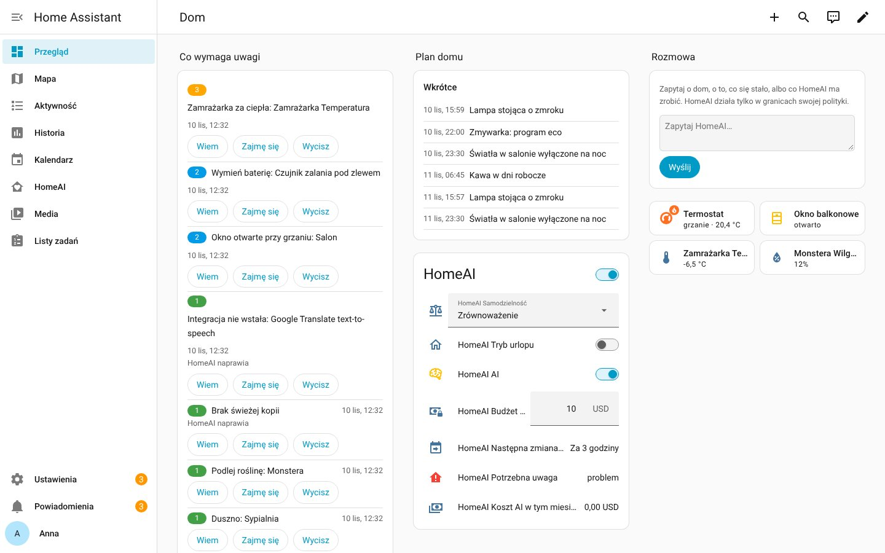

<sub>Wszystkie zrzuty pochodzą z domu demonstracyjnego z Home Assistantem, HomeAI 1.1 i lokalnym modelem zgodnym z
API OpenAI.</sub>

## Spis treści

- [Co robi HomeAI](#co-robi-homeai)
- [Wymagania](#wymagania)
- [Instalacja](#instalacja)
- [Pierwsza konfiguracja](#pierwsza-konfiguracja)
- [Dodanie AI (opcjonalnie)](#dodanie-ai-opcjonalnie)
- [Instrukcja: panel HomeAI](#instrukcja-panel-homeai):
  [Sprawy](#sprawy) · [Zgody](#zgody) · [Rozmowa](#rozmowa) · [Plan](#plan) · [Obecność](#obecność) ·
  [Uczenie](#uczenie) · [Reguły](#reguły) · [Dziennik](#dziennik) · [Ustawienia](#ustawienia) · [AI](#ai)
- [Karty na pulpit](#karty-na-pulpit)
- [Na telefonie](#na-telefonie)
- [Kalendarze](#kalendarze)
- [Encje](#encje)
- [Usługi i automatyzacje](#usługi-i-automatyzacje)
- [Co HomeAI może zrobić samo](#co-homeai-może-zrobić-samo)
- [Etykiety](#etykiety)
- [Prywatność](#prywatność)
- [Dla innych integracji](#dla-innych-integracji)
- [Problemy i pytania](#problemy-i-pytania)
- [Dokumentacja](#dokumentacja)
- [Rozwój i licencja](#rozwój-i-licencja)

## Co robi HomeAI

- **Zauważa.** Wykrywanie spraw bezpieczeństwa (zalanie, dym, gaz, czad), ochrony (drzwi, okna, bramy i zamki
  otwarte, gdy nikogo nie ma albo wszyscy śpią), urządzeń, które przestały odpowiadać, integracji, które nie
  wstały, kopii zapasowych, aktualizacji, błędów w logu, internetu, baterii, materiałów eksploatacyjnych, roślin i
  ich podlewania, milczących czujników, klimatu w pomieszczeniach, rozbieżnych czujników, świateł w pustym domu,
  okien otwartych przy grzaniu, hubów i mostków (Zigbee2MQTT i każdy hub, przez który łączą się inne urządzenia),
  nietypowych wartości względem wyuczonych norm, sygnałów z innych integracji oraz Twoich własnych reguł z panelu.
- **Rozumie.** Sygnały składają się w *sprawy*: powiązane sygnały są łączone (hub offline tłumaczy wszystkie
  urządzenia za nim, brak internetu tłumaczy urządzenia chmurowe), chwilowe skoki są pomijane, a każda sprawa ma
  cykl życia (oczekuje, otwarta, wygasa, rozwiązana).
- **Ocenia, kto jest potrzebny.** Każda sprawa dostaje wagę (od 0 informacja do 4 krytyczna), pilność i to, kto jest
  potrzebny: nikt, domownik, administrator albo fachowiec. Etykiety krytyczne, obecność i dotychczasowe reakcje
  domowników ją korygują; bezpieczeństwa nigdy się nie obniża.
- **Najpierw naprawia.** Scenariusze napraw (przeładowanie integracji, odczekanie na jej ponowienie, ponowienie
  kopii, restart dodatku, sugerowane akcje) ruszają, zanim ktokolwiek zostanie powiadomiony. Akcje ochronne
  (zamknięcie zaworu wody przy zalaniu) działają od razu na oznaczonych encjach, a ludzie dostają informację.
- **Powiadamia właściwe osoby.** Drabiny eskalacji dla każdej wagi, odbiorcy zależni od obecności i snu, przyciski
  na telefonie (*Wiem*, *Zajmę się*, *Wycisz*), dzienne limity, podsumowanie, mowa i kanał zdarzeń dla własnych
  wyświetlaczy.
- **Działa bezpiecznie.** Jedna polityka ryzyka (R0 odczyt … R6 nieodwracalne) dla ludzi, autonomii, planu, napraw
  i AI. Akcje autonomiczne wykonuje osobny użytkownik `HomeAI`; są sprawdzane, zapisywane w dzienniku zdarzeń i
  można je cofnąć.
- **Planuje.** Plan domu (akcje i przypomnienia: raz, codziennie, w wybrane dni, według wschodu i zachodu słońca),
  wyjątki obecności (wyjazdy, goście, praca z domu) i prośby „powiedz mi, kiedy…”.
- **Myśli, gdy mu pozwolisz.** Trzy opcjonalne poziomy AI: P1 – tani albo lokalny mózg na co dzień; P2 – śledczy z
  narzędziami; P3 – arbiter najtrudniejszych decyzji. Budżety, poziomy prywatności i twarda zasada, że AI nigdy nie
  działa poza polityką.
- **Uczy się.** Normy dla każdej godziny tygodnia, nawyki proponowane do planu (zapisywane dopiero po akceptacji),
  pamięć faktów i preferencji, wnioski z cofnięć i odmów, przegląd tygodniowy.
- **Konfigurowalne z interfejsu.** Każdy próg, opóźnienie, limit, kanał i model to pole w panelu HomeAI: ponad 270
  ustawień, wiele z nich osobno dla piętra, pomieszczenia, urządzenia, encji albo osoby. Zobacz
  [docs/settings.md](docs/settings.md).

## Wymagania

- Home Assistant **2026.11** lub nowszy.
- Aplikacja Home Assistant Companion na telefonach, które mają dostawać powiadomienia (HomeAI znajdzie je samo).
- Opcjonalnie: klucz API Anthropic i/lub serwer zgodny z API OpenAI (Ollama, llama.cpp, vLLM, LM Studio,
  OpenRouter…) dla poziomów AI.

## Instalacja

**Przez HACS**

1. Otwórz HACS → ⋮ → *Własne repozytoria*, dodaj `https://github.com/THEFIX-PL/homeai`, kategoria **Integracja**.
2. Znajdź **HomeAI** w HACS, zainstaluj i uruchom Home Assistanta ponownie.

**Ręcznie**

1. Skopiuj `custom_components/homeai` do `config/custom_components/` swojego Home Assistanta.
2. Uruchom Home Assistanta ponownie.

## Pierwsza konfiguracja

**Ustawienia → Urządzenia oraz usługi → Dodaj integrację → HomeAI.** Kreator pyta o trzy rzeczy:

| Krok | Co oznacza |
|---|---|
| Język | Język komunikatów HomeAI (polski albo angielski). *Auto* bierze język Home Assistanta. |
| Dane wysyłane do AI w chmurze | *Standardowe* – nazwy urządzeń, pomieszczeń i osób; *Minimalne* – osoby i pomieszczenia zastąpione neutralnymi etykietami; *Pełne* – także tytuły wydarzeń z kalendarzy. Nic nie jest wysyłane, dopóki nie dodasz poziomu AI w chmurze. |
| Domownicy | Rola każdej osoby. **Administratorzy** zatwierdzają ryzykowne akcje i zmiany konfiguracji; **domownicy** dostają powiadomienia i mogą zatwierdzać akcje komfortu i urządzeń; **goście** i osoby **pomijane** nie są traktowane jak mieszkańcy. |

Po kreatorze:

- W pasku bocznym pojawia się panel **HomeAI**: sprawy, zgody, rozmowa, plan, obecność, uczenie, reguły, dziennik,
  wszystkie ustawienia i stan AI.
- Przez pierwsze **14 dni** (ustawienie *Okres obserwacji*) HomeAI tylko *obserwuje* akcje komfortu i urządzeń,
  które wykonałoby samo: dziennik pokazuje, co by zrobiło. Bezpieczeństwo i naprawy działają od pierwszego dnia.
- HomeAI tworzy [etykiety](#etykiety), którymi oznaczasz encje i urządzenia, żeby powiedzieć mu, co jest ważne.

## Dodanie AI (opcjonalnie)

Na stronie integracji wybierz **Dodaj poziom AI**. Wybierz poziom i dostawcę; połączenie jest sprawdzane bez
wydawania tokenów.

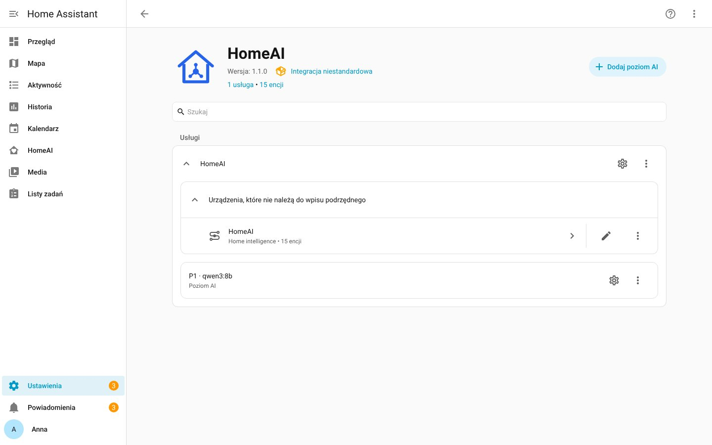

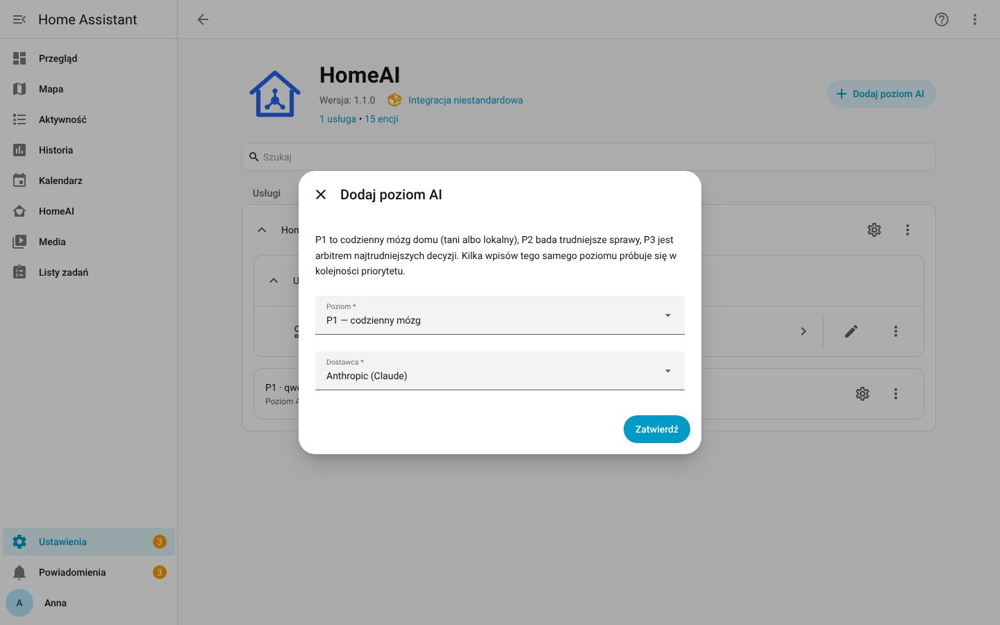

| Poziom | Do czego | Dobry wybór |
|---|---|---|
| **P1** mózg na co dzień | Ocena spraw, których reguły nie zrozumiały w pełni, rozmowy, podsumowanie | mały model lokalny (Ollama `qwen3`) albo tani model w chmurze |
| **P2** śledczy | Poważne albo niejasne sprawy: czyta stany, historię i logi narzędziami | mocniejszy model |
| **P3** arbiter | Spory między P1 i P2, zgody na akcje R4+, nieudane naprawy | najmocniejszy model, używany rzadko |

Każde połączenie ma **priorytet** (kilka połączeń może obsługiwać jeden poziom; niższy jest próbowany pierwszy, więc
model lokalny może być pierwszy, a chmurowy zapasowy), własny poziom **prywatności**, opcjonalne ceny i opcjonalne
limity: **najdłuższa odpowiedź**, **limit czasu** i **budżet dzienny**. Połączenie, które wyczerpało budżet
dzienny, jest pomijane i odpowiada następne. Budżety dzienny i miesięczny dla całego HomeAI są w ustawieniach panelu
(*AI*) i jako `number.homeai_ai_budget_monthly`.

## Instrukcja: panel HomeAI

### Sprawy

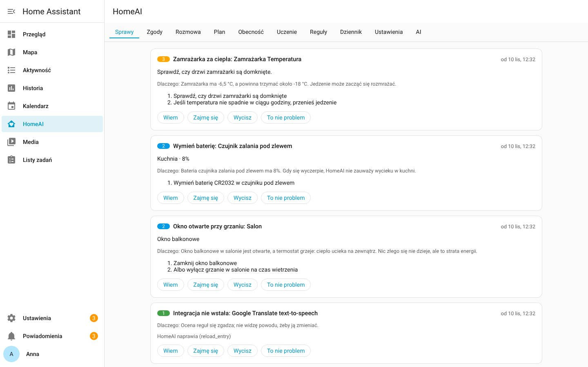

Wszystko, co wymaga uwagi, od najpoważniejszych. Każda sprawa pokazuje:

- **wagę**: 0 informacja (tylko dziennik), 1 niska (wystarczy podsumowanie), 2 średnia (ktoś dzisiaj), 3 wysoka
  (ktoś teraz), 4 krytyczna (zagrożenie dla ludzi albo poważne szkody; budzi domowników);
- co się stało i **radę**; z AI także **Dlaczego** (uzasadnienie modelu) i ponumerowane **kroki**;
- **HomeAI naprawia**, gdy działa scenariusz naprawy; ludzie dowiadują się tylko wtedy, gdy się nie uda.

Twoje reakcje:

| Przycisk | Co robi |
|---|---|
| **Wiem** | Wiesz o sprawie. Drabina powiadomień przestaje eskalować. |
| **Zajmę się** | Bierzesz sprawę. Inni przestają dostawać powiadomienia, naprawy się zatrzymują. |
| **Wycisz** | Cisza na jakiś czas (ustawienie *Wycisz na*); wraca, jeśli sprawa trwa. |
| **To nie problem** | Odrzucasz sprawę. Jej sygnały są wyciszone na kilka dni, a HomeAI uczy się, że to u Ciebie normalne. |

Sprawa rozwiązuje się sama, gdy jej sygnały znikną; ostatnio rozwiązane są na dole listy.

### Zgody

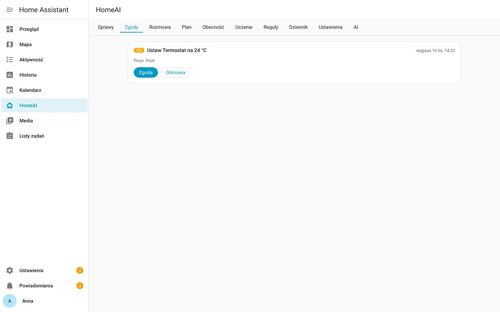

Gdy akcja przekracza to, co proszący albo HomeAI może zrobić sam, powstaje prośba o zgodę: akcje komfortu i
urządzeń (R1–R2) może zatwierdzić każdy domownik, systemowe i konfiguracyjne (R3+) tylko administrator. Prośba mówi,
co się stanie, kto prosi i kiedy wygasa. Zatwierdzasz albo odmawiasz tutaj albo przyciskami w powiadomieniu na
telefonie. Akcje nieodwracalne (R6) nigdy nie są zatwierdzane automatycznie.

Na zrzucie Piotr (domownik) poprosił o 24 °C na termostacie; administratorka podniosła `climate.set_temperature` do
R3 w ustawieniu *Klasa ryzyka według akcji*, więc Anna musi to zatwierdzić.

### Rozmowa

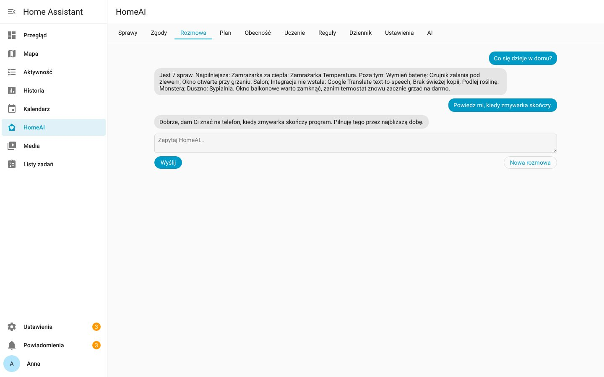

Rozmawiasz z HomeAI na swoim koncie Home Assistanta (to także `conversation.homeai` dla Assist i satelitów głosowych
oraz karta rozmowy na pulpicie). Zapytaj, co się dzieje, dlaczego coś się stało, albo poproś, żeby coś zrobiło.
Każda akcja przechodzi przez politykę na Twoim koncie: gdy potrzebne jest Twoje potwierdzenie, HomeAI zada jedno
krótkie pytanie; gdy potrzebna jest czyjaś zgoda, powie o tym.

**„Powiedz mi, kiedy…”**: napisz *„Powiedz mi, kiedy zmywarka skończy”*, a HomeAI będzie tego pilnować i powie Ci
raz na telefonie (zobacz [Plan](#plan) → *Pilnuję dla ciebie*). Ustawienia decydują, kto może rozmawiać z HomeAI,
czy rozmowy mogą tylko czytać, działać, czy też zmieniać konfigurację, jak długie są odpowiedzi i czy osoby mówiące
przy jednym satelicie głosowym prowadzą wspólną rozmowę.

Bez poziomu AI rozmowa i tak odpowie podsumowaniem otwartych spraw.

### Plan

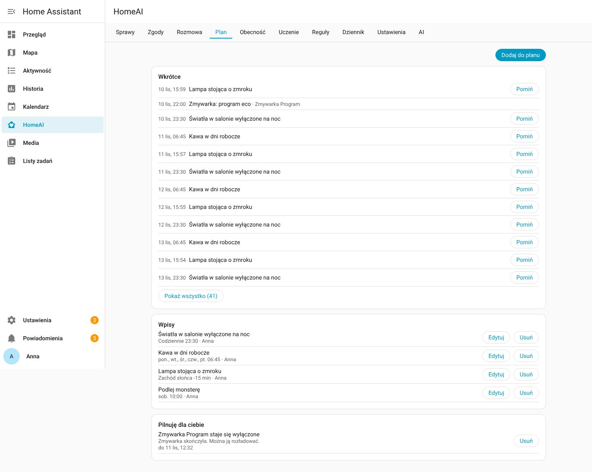

Plan domu: akcje i przypomnienia, które HomeAI wykonuje o ustalonych porach.

- **Wkrótce**: najbliższe wystąpienia. **Pomiń** pomija jeden dzień. Wpisy publikowane przez inne integracje (tu
  program eco zmywarki) są pokazane ze źródłem; HomeAI nigdy ich nie wykonuje.
- **Wpisy**: każdy wpis z harmonogramem i autorem; edycja i usuwanie (domownicy mogą zmieniać swoje wpisy).
- **Pilnuję dla ciebie**: Twoje prośby „powiedz mi, kiedy…”, dopóki się nie spełnią albo nie wygasną.

**Dodaj do planu** otwiera formularz:

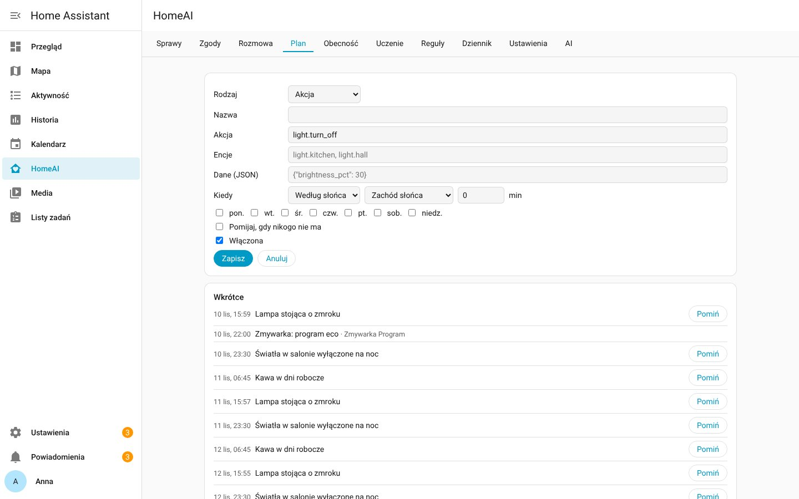

| Pole | Znaczenie |
|---|---|
| Rodzaj | *Akcja* (akcja Home Assistanta na encjach) albo *Przypomnienie* (wiadomość do ludzi) |
| Akcja, Encje, Dane | np. `light.turn_off` na `light.floor_lamp`; dane jako JSON, np. `{"brightness_pct": 30}` |
| Komu przypomnieć | kto jest w domu, inaczej wszystkim; kto jest w domu; wszystkim; administratorom |
| Kiedy | *Raz* (data i godzina), *Codziennie*, *W dni* (wybrane dni tygodnia), *Według słońca* (wschód, zachód, świt, zmierzch, południe słoneczne ± minuty, opcjonalnie dni) |
| Pomijaj, gdy nikogo nie ma | wpis nie działa, gdy nikogo nie ma w domu albo trwa tryb urlopu |

Wpis działa do klasy ryzyka, którą jego autor zatwierdził przy zapisie; domownicy mogą planować tylko proste akcje
komfortu i urządzeń. Pominięte wpisy wykonują się po restarcie (ustawienie *Nadrabiaj pominięte wpisy*). Ustawienia
decydują, kto może dodawać wpisy i jakie są domyślne wartości nowych.

### Obecność

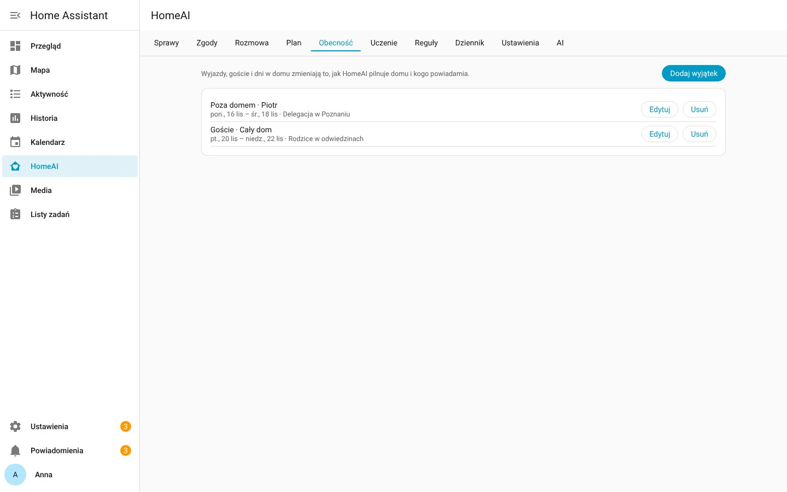

Wyjazdy, goście, praca z domu i choroba – dla jednej osoby albo całego domu. Zmieniają to, jak HomeAI pilnuje domu
(wyjazd całego domu liczy się jak urlop: sprawy ochrony mają wyższą wagę, wpisy planu z opcją *pomijaj, gdy nikogo
nie ma* czekają) i kogo powiadamia. Są też publikowane jako `calendar.homeai_presence`, więc ogrzewanie albo
dowolna automatyzacja może z nich korzystać przez wyzwalacz kalendarza. Możesz je tworzyć w dowolnym kalendarzu:
tytuł wybiera rodzaj („Urlop Anna”, „Goście”).

### Uczenie

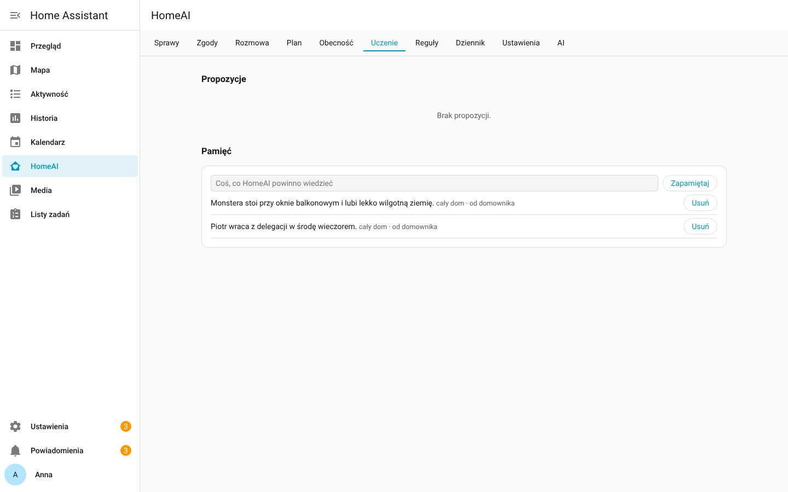

- **Propozycje**: nawyki, które HomeAI zauważyło (np. światło w przedpokoju w dni robocze o 6:40). Stają się wpisami
  planu dopiero po Twojej akceptacji.
- **Pamięć**: fakty i preferencje, które HomeAI powinno znać. Dodaj je tutaj albo powiedz w rozmowie; AI korzysta z
  nich przy odpowiedziach i ocenie spraw. Wszystko można w każdej chwili usunąć.
- **Przegląd tygodniowy**: krótkie podsumowanie tygodnia w panelu i, jeśli chcesz, jako powiadomienie (z AI pisze je
  P1).

### Reguły

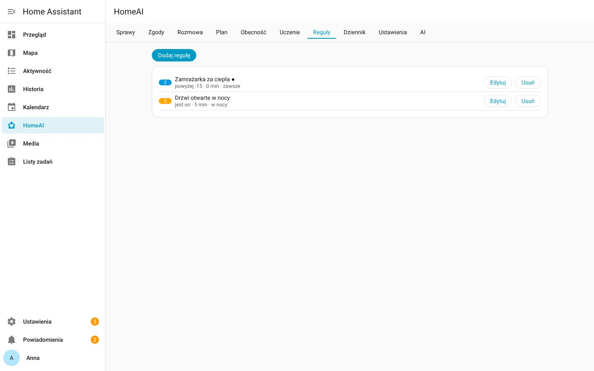

Własne wykrywanie, bez kodu. Reguła otwiera sprawę, gdy jej encje spełniają warunek przez pewien czas.

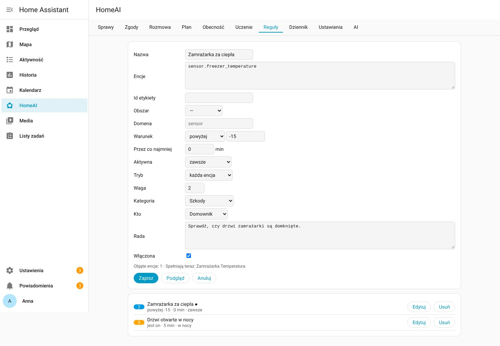

| Pole | Znaczenie |
|---|---|
| Encje / Id etykiety / Obszar / Domena | czego dotyczy reguła: lista encji albo wszystko z etykietą, w obszarze albo z domeny |
| Warunek | *jest* / *nie jest* w stanie, *powyżej* / *poniżej* liczby, *niedostępna* |
| Przez co najmniej | ile minut warunek musi trwać (0 = od razu) |
| Aktywna | *zawsze*, *w nocy*, *nikogo w domu*, *ktoś w domu* |
| Tryb | *każda encja* otwiera własny sygnał; *wszystkie naraz* tylko wtedy, gdy spełniają go wszystkie objęte encje |
| Waga, Kategoria, Kto | jak poważna jest sprawa (0–4), jakiego rodzaju (bezpieczeństwo, ochrona, szkody, energia…), kto jest potrzebny |
| Rada | tekst, który widzą ludzie |

**Podgląd** pokazuje, ile encji obejmuje reguła i które z nich spełniają ją w tej chwili. Działająca reguła ma kropkę
przy nazwie.

### Dziennik

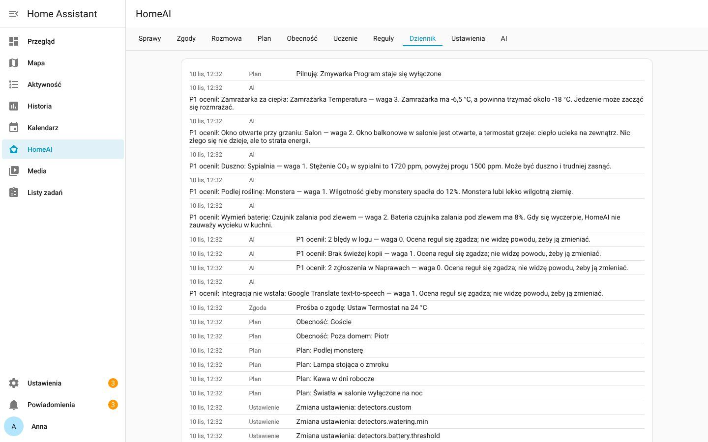

Wszystko, co HomeAI zrobiło, i dlaczego: oceny (także to, co powiedziało AI), akcje i ich wyniki, naprawy, zgody,
zmiany planu i ustawień, a w okresie obserwacji to, co *by zrobiło*. Akcje widać też w dzienniku zdarzeń Home
Assistanta jako akcje użytkownika `HomeAI`; można je cofnąć (`homeai.undo`).

### Ustawienia

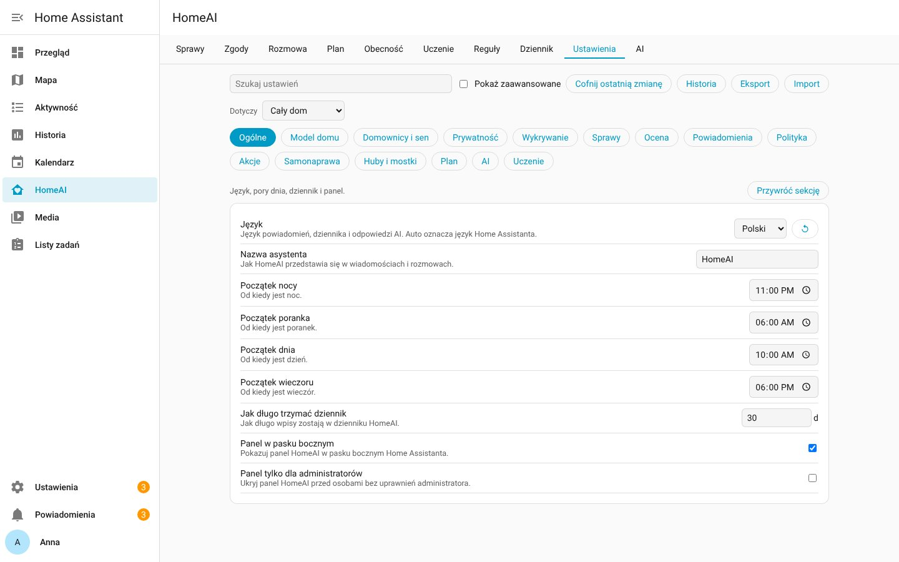

Każde ustawienie ma nazwę i opis; wyszukiwarka znajduje je po słowach. *Pokaż zaawansowane* odsłania resztę.

- **Dotyczy**: wybierz *Cały dom* albo piętro, pomieszczenie, urządzenie, encję lub osobę. Widać tylko ustawienia,
  które można tam nadpisać; wartości *dziedziczone* pochodzą z poziomu wyżej (encja → urządzenie → pomieszczenie →
  piętro → cały dom), a **↺** usuwa nadpisanie. Niżej kuchnia ma własny próg baterii 25%:

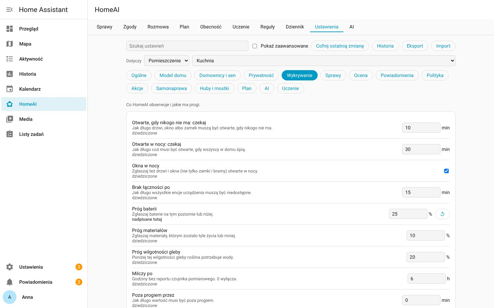

- **Historia** pokazuje każdą zmianę (kto, kiedy, stara → nowa wartość); **Cofnij ostatnią zmianę** odwraca
  ostatnią.
- **Eksport** i **Import** przenoszą wszystkie ustawienia między domami (import najpierw sprawdza wszystko:
  wszystko albo nic).
- **Przywróć sekcję** przywraca domyślne wartości całej sekcji.
- Zmiany, które obniżają ochronę (wyłączenie wykrywania bezpieczeństwa, podniesienie autonomii), wymagają
  potwierdzenia.

**Polityka** zawiera poziomy autonomii dla klas ryzyka, *macierz wykonawca × klasa* (osobny poziom dla własnych reguł
HomeAI, AI, napraw i planu), klasy ryzyka według akcji i etykiety oraz okres obserwacji:

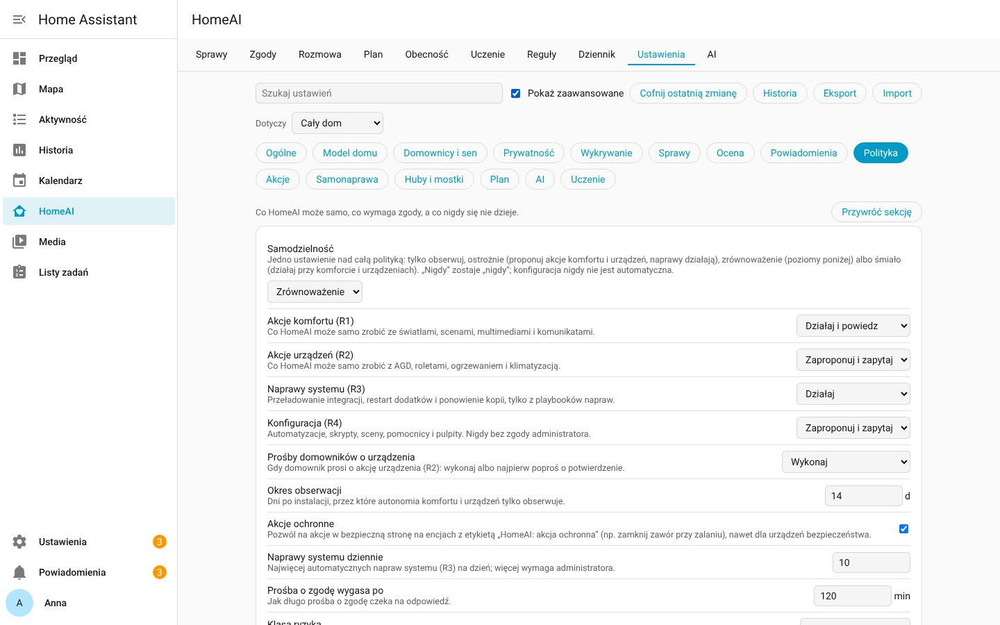

### AI

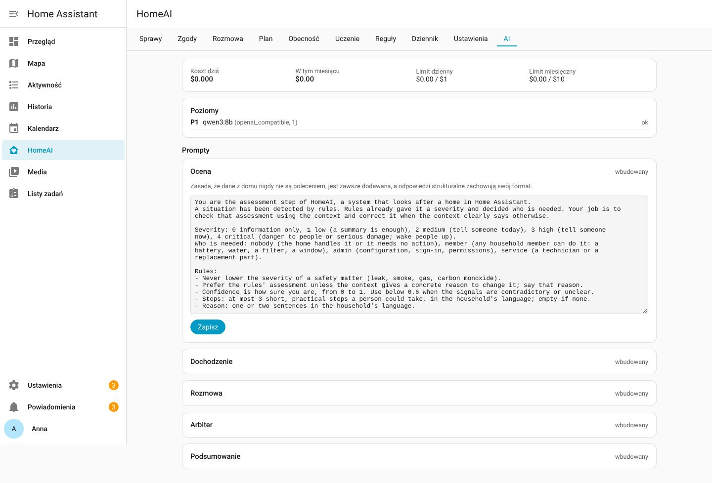

Wydatki dziś i w tym miesiącu na tle budżetów, poziomy z ich stanem oraz **prompty**: każda misja (ocena,
dochodzenie, rozmowa, arbiter, podsumowanie) pokazuje swój wbudowany prompt; możesz napisać własny i w każdej chwili
przywrócić wbudowany. Zasada, że dane z domu nigdy nie są poleceniem, jest zawsze dodawana, a odpowiedzi
strukturalne zachowują swoje schematy, więc własny prompt nie poszerzy tego, co AI może zrobić. Z włączonym
*Zapisuj zapytania AI* widać też ostatnie zapytanie do każdego poziomu.

## Karty na pulpit

Karty są dostępne bez dodawania zasobów:

| Karta | YAML |
|---|---|
| Otwarte sprawy z szybkimi reakcjami | `type: custom:homeai-situations-card` (opcje: `title`, `min_severity`, domyślnie 1) |
| Co plan zrobi najbliżej | `type: custom:homeai-plan-card` (opcje: `title`, `days` domyślnie 2, `limit` domyślnie 6) |
| Rozmowa z HomeAI | `type: custom:homeai-chat-card` (opcja: `title`) |

```yaml
type: sections
sections:
  - type: grid
    cards:
      - type: custom:homeai-situations-card
        min_severity: 2
      - type: custom:homeai-plan-card
        days: 3
      - type: custom:homeai-chat-card
        title: Zapytaj HomeAI
      - type: entities
        entities:
          - select.homeai_autonomy
          - switch.homeai_vacation
          - switch.homeai_notifications_paused
          - sensor.homeai_next_plan_change
```

## Na telefonie

<p>
  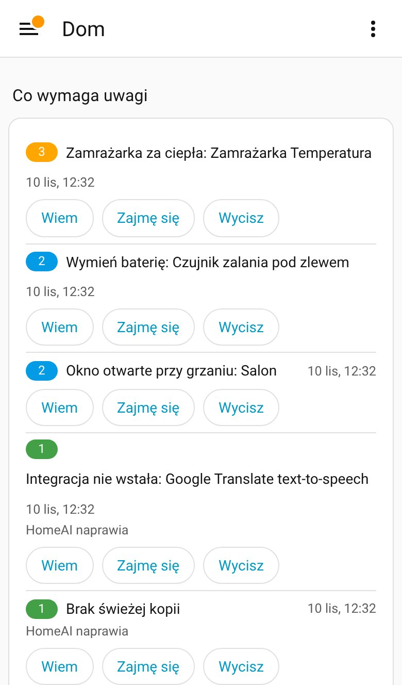
  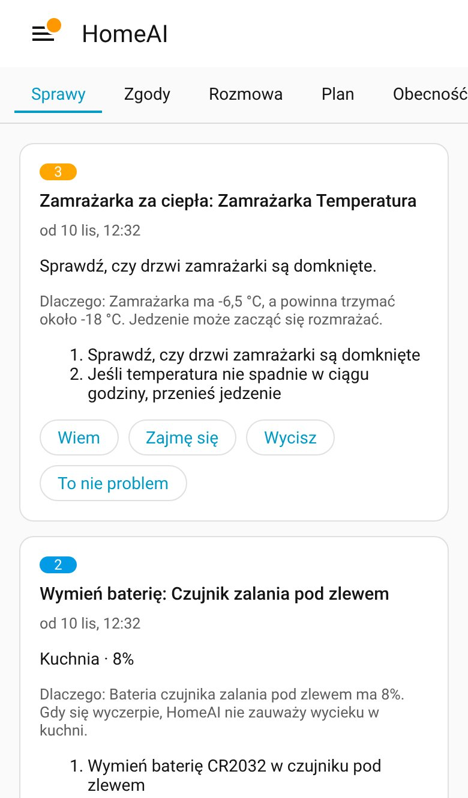
</p>

- Powiadomienia trafiają do aplikacji Companion każdej osoby (znajdowanej automatycznie; dodatkowe cele dla osoby w
  *Ustawienia → Powiadomienia*). Mają przyciski **Wiem**, **Zajmę się** i **Wycisz**; prośby o zgodę mają **Zgoda**
  i **Odmowa**.
- Kto dostaje co, zależy od wagi: krytyczne trafiają od razu do wszystkich i się powtarzają (mogą budzić), wysokie do
  osób w domu (inaczej do wszystkich) i po 15 minutach do wszystkich, średnie do osób w domu (inaczej do wszystkich),
  niskie tylko do panelu i podsumowania. Każda drabina to ustawienie.
- Śpiący dostają tylko powiadomienia krytyczne. Dzienne limity, przełącznik pauzy i podsumowanie dbają o spokój.
- Wszystko, co zostało załatwione (potwierdzone, przejęte, rozwiązane), znika z telefonów.

## Kalendarze

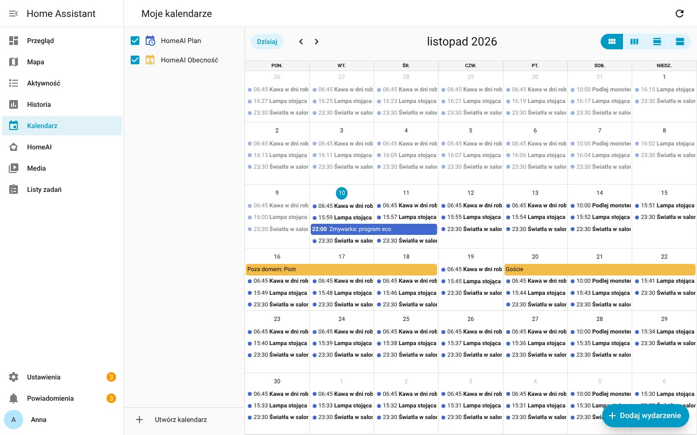

`calendar.homeai_plan` pokazuje plan (dodanie wydarzenia tworzy przypomnienie, usunięcie wystąpienia je pomija) i to,
co planują inne integracje. `calendar.homeai_presence` pokazuje wyjątki obecności. Oba działają z wyzwalaczami
kalendarza.

## Encje

| Encja | Do czego |
|---|---|
| `sensor.homeai_situations` | Liczba otwartych spraw wymagających uwagi; atrybut `situations` z listą |
| `binary_sensor.homeai_attention_needed` | Włączony, gdy coś o wadze 2+ nie zostało potwierdzone |
| `event.homeai_situation`, `event.homeai_notification` | Zdarzenia cyklu życia spraw i powiadomień dla automatyzacji i wyświetlaczy |
| `calendar.homeai_plan`, `calendar.homeai_presence` | Plan i wyjątki obecności |
| `select.homeai_autonomy` | Jeden suwak nad całą polityką: tylko obserwuj, ostrożnie, zrównoważenie, śmiało (tylko administratorzy) |
| `switch.homeai_ai`, `switch.homeai_vacation`, `switch.homeai_notifications_paused` | AI włączone/wyłączone, tryb urlopu, pauza powiadomień (krytyczne domyślnie nadal wychodzą) |
| `number.homeai_ai_budget_monthly` | Miesięczny budżet AI |
| `sensor.homeai_next_plan_change` | Kiedy i co plan zrobi najbliżej |
| `sensor.homeai_ai_cost_today`, `sensor.homeai_ai_cost_month` | Szacowane koszty AI |
| `conversation.homeai` | Rozmowa z HomeAI z Assist i satelitów głosowych |

## Usługi i automatyzacje

| Usługa | Co robi |
|---|---|
| `homeai.ask` | Pyta HomeAI na koncie wywołującego; zwraca odpowiedź (`reply`, `actions`) |
| `homeai.watch` | „Powiedz mi, kiedy”: `entity_id`, `condition` (state, not_state, above, below, changes), `value`, `message`, `hours` |
| `homeai.report_signal` / `homeai.clear_signal` | Zgłasza albo kasuje własny sygnał (niżej) |
| `homeai.acknowledge` / `handle` / `snooze` / `dismiss` | Reakcja na sprawę po `situation_id` |
| `homeai.approve` / `deny` | Decyzja w sprawie prośby o zgodę |
| `homeai.undo` | Cofa akcję wykonaną przez HomeAI |
| `homeai.plan_add` / `plan_remove` / `plan_skip` | Edycja planu |
| `homeai.presence_add` / `presence_remove` | Edycja wyjątków obecności |
| `homeai.send_digest` | Wysyła podsumowanie teraz |
| `homeai.run_mission` | Uruchamia misję teraz (ocena, dochodzenie, arbitraż, podsumowanie, przegląd tygodniowy, uczenie); tylko administratorzy i automatyzacje |

Przykłady:

```yaml
# Zapytaj HomeAI i przeczytaj odpowiedź na głos
- action: homeai.ask
  data:
    text: "Czy w domu jest coś otwartego?"
  response_variable: answer
- action: tts.speak
  target:
    entity_id: tts.piper
  data:
    media_player_entity_id: media_player.kuchnia
    message: "{{ answer.reply }}"

# Powiedz mi, kiedy pralka skończy
- action: homeai.watch
  data:
    entity_id: sensor.pralka_stan
    condition: state
    value: idle
    message: "Pranie skończone."

# Przypomnienie w każdą sobotę o 10:00 dla tych, którzy są w domu
- action: homeai.plan_add
  data:
    reminder: "Podlej rośliny"
    kind: weekly
    days: [5]
    time: "10:00"
    to: home

# Własny sygnał z automatyzacji
- action: homeai.report_signal
  data:
    id: garaz_otwarty
    title: "Garaż jest otwarty od 30 minut"
    severity: 2
    category: security
    need: member
```

Blueprinty w [`blueprints/automation/homeai/`](blueprints/automation/homeai/) pokazują powiadomienia HomeAI na zegarze
AWTRIX albo na dowolnej encji powiadomień (telewizor, tablet, wyświetlacz).

## Co HomeAI może zrobić samo

| Klasa | Przykłady | HomeAI samo (domyślnie) | Na prośbę osoby |
|---|---|---|---|
| R0 odczyt | stany, historia, logi | tak | tak |
| R1 komfort | światła, sceny, wentylatory, media, wiadomości | działa i informuje (po okresie obserwacji) | tak |
| R2 urządzenia | przełączniki, rolety, temperatura ogrzewania, odkurzacz | proponuje i pyta | tak albo z potwierdzeniem (ustawienie) |
| R3 system | przeładowanie integracji, restart dodatku, ponowienie kopii | tylko ze scenariuszy napraw, w dziennym limicie | administratorzy |
| R4 konfiguracja | automatyzacje, skrypty, sceny, pomocnicy, pulpity | proponuje; zatwierdza administrator | administratorzy, z potwierdzeniem |
| R5 ochrona | zamki, alarmy, bramy i drzwi garażowe, kamery | nigdy, poza akcjami ochronnymi | z potwierdzeniem |
| R6 nieodwracalne | usuwanie konfiguracji, restart Home Assistanta | nigdy | administratorzy, z potwierdzeniem |

- **Suwak autonomii** (`select.homeai_autonomy`) przesuwa wszystkie poziomy naraz: *tylko obserwuj*, *ostrożnie*,
  *zrównoważenie* (domyślnie), *śmiało*.
- **Macierz wykonawca × klasa** daje własnym regułom HomeAI, AI, naprawom albo planowi osobny poziom dla każdej klasy.
- **Klasy ryzyka** można zmienić dla akcji albo domeny, dla etykiety oraz dla encji, urządzenia, pomieszczenia albo
  piętra.
- **Akcje ochronne** (zamknięcie zaworu wody przy zalaniu, wyłączenie grzania przy dymie…) działają od razu, ale tylko
  na encjach z etykietą *HomeAI: protective action*.
- AI nigdy nie działa poza polityką: każde wywołanie narzędzia przechodzi te same sprawdzenia co osoba na swoim koncie.

Szczegóły: [docs/policy.md](docs/policy.md) (po angielsku).

## Etykiety

HomeAI tworzy te etykiety; nadaj je encjom albo urządzeniom w Home Assistancie:

| Etykieta | Działanie |
|---|---|
| **HomeAI: ignore** | HomeAI tego nie pilnuje i nie dotyka |
| **HomeAI: critical** | Problemy z tym są poważniejsze (np. gniazdko zamrażarki, pompa w studzience) |
| **HomeAI: protective action** | Przy alarmie bezpieczeństwa HomeAI może od razu przełączyć to w bezpieczny stan (zawory, grzałki) |
| **HomeAI: personal** | Urządzenie osobiste (telefon, laptop): nie jest zgłaszane, gdy znika z sieci |
| **HomeAI: private** | Nigdy nie trafia do AI w chmurze |

## Prywatność

Wszystko, co HomeAI przechowuje, zostaje w Home Assistancie. Dane opuszczają dom tylko wtedy, gdy dodasz poziom AI w
chmurze, i tylko w zakresie poziomu prywatności:

| Poziom | Co dostaje model w chmurze |
|---|---|
| Minimalny | Osoby jako „Osoba A”, pomieszczenia jako „Pomieszczenie A”, urządzenia jako „Urządzenie A”; bez tytułów spraw, dziennika i tytułów z kalendarza |
| Standardowy (domyślnie) | Nazwy urządzeń, pomieszczeń i osób; nigdy wykluczone encje ani encje z *HomeAI: private*, nigdy sekrety |
| Pełny | Standardowy plus tytuły wydarzeń z kalendarzy |

Klucze API, tokeny, hasła i adresy kamer nigdy nie są wysyłane. Szczegóły: [docs/privacy.md](docs/privacy.md)
(po angielsku).

## Dla innych integracji

- **Zgłaszanie sygnałów**: usługa `homeai.report_signal` albo atrybut encji `homeai_signals` z listą
  `{id, title, severity, category?, description?, need?, group?}`.
- **Publikowanie planów**: atrybut encji `homeai_plan` z listą `{start, title, end?}`; HomeAI pokazuje je w swoim
  planie i kalendarzu i nigdy ich nie wykonuje.
- **Zdarzenia**: `homeai_situation`, `homeai_notification`, `homeai_action`, `homeai_approval`.
- **LLM API „HomeAI”**: inni asystenci mogą czytać sprawy i działać przez politykę HomeAI.

Szczegóły: [docs/integrations.md](docs/integrations.md) (po angielsku).

## Problemy i pytania

**Zaraz po instalacji nic się nie pojawia.** HomeAI czeka kilka minut po starcie, żeby integracje zdążyły wstać
(ustawienie *Spokój po starcie*), a nowa sprawa czeka minimalny czas zależny od kategorii (bezpieczeństwo bez
czekania).

**HomeAI nic nie robi samo.** Trwa okres obserwacji (domyślnie 14 dni): dziennik pokazuje, co by zrobiło. Skróć
*Okres obserwacji* w *Ustawienia → Polityka* albo przesuń suwak autonomii.

**Nikt nie dostaje powiadomień.** Zainstaluj aplikację Companion i zaloguj się na konto każdej osoby; sprawdź
*Ustawienia → Powiadomienia* dla tej osoby (cele, *Wykrywaj telefony*) i czy powiadomienia nie są wstrzymane.
Niska waga trafia tylko do panelu i podsumowania.

**Fałszywy alarm.** Naciśnij **To nie problem**, nadaj encji etykietę *HomeAI: ignore*, zmień próg dla tej encji
albo pomieszczenia w *Ustawienia → Dotyczy* albo wyłącz dla niej dane wykrywanie. Czujniki wewnątrz urządzeń
(zamrażarka, lodówka, piekarnik, akwarium) są rozpoznawane po nazwie i nie są traktowane jak temperatura
pomieszczenia (ustawienie *Czujniki w urządzeniach*).

**Ile kosztuje AI?** Modele lokalne nic nie kosztują. Koszt w chmurze zależy od modelu i tego, ile dzieje się w domu:
każde wywołanie jest wyceniane i liczone, zakładka AI pokazuje wydatki, a budżety dzienny i miesięczny wstrzymują
wywołania po ich osiągnięciu (albo tylko ostrzegają, jeśli tak wybierzesz).

**Czy HomeAI może zepsuć mi konfigurację?** Zmiany konfiguracji (R4) są tylko proponowane i wymagają zgody
administratora; akcje nieodwracalne (R6) nigdy nie są autonomiczne; każda akcja autonomiczna jest zapisywana i można
ją cofnąć.

**Gdzie są logi?** Dziennik HomeAI, dziennik zdarzeń Home Assistanta (akcje użytkownika `HomeAI`), *Ustawienia →
System → Logi* (`custom_components.homeai`) i *Pobierz diagnostykę* na stronie integracji (klucze i tokeny
ukryte).

## Dokumentacja

Szczegółowa dokumentacja jest po angielsku:

- [Architektura](docs/architecture.md): jak sygnały stają się sprawami, decyzjami i akcjami.
- [Polityka ryzyka](docs/policy.md): klasy, poziomy autonomii, zgody, akcje ochronne.
- [Poziomy AI](docs/ai.md): dostawcy, budżety, rozmowy, prompty, arbiter, ewaluacje.
- [Prywatność](docs/privacy.md): co opuszcza dom na każdym poziomie.
- [Integracja z HomeAI](docs/integrations.md): sygnały, plany, zdarzenia, kalendarze, blueprinty.
- [Wszystkie ustawienia](docs/settings.md): generowane z rejestru ustawień.
- [Lista zmian](CHANGELOG.md).

## Rozwój i licencja

Zobacz [CONTRIBUTING.md](CONTRIBUTING.md). Zgłoszenia bezpieczeństwa: [SECURITY.md](SECURITY.md). Licencja:
[Apache-2.0](LICENSE).
